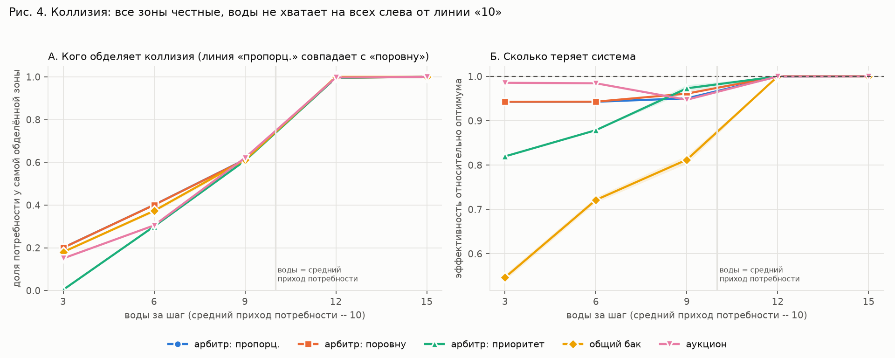
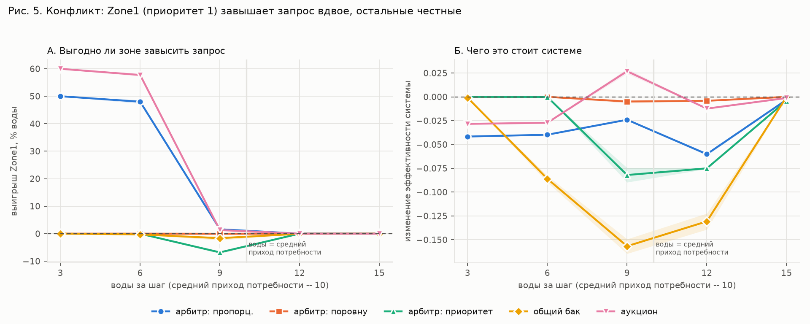

# Коллизия и конфликт в распределении воды: эксперимент без LLM

Эксперимент на модели конфликта m2m (Mesa, 3 зоны орошения, 5 механизмов
распределения). Никакой LLM: поведение зон задано явно — честный запрос или
запрос, завышенный вдвое. Скрипт — `experiments/conflict_collision.py`
(2000 прогонов, ~20 секунд), полные таблицы —
`experiments/results/conflict_collision_summary.md`.

## Главное

1. **Коллизия появляется только при нехватке воды и исчезает, как только
   воды хватает.** Начиная с 12 единиц за шаг (средний приход потребности —
   10) все механизмы дают эффективность 1.0 и равные доли. Всё интересное —
   слева от этой границы.
2. **Механизмы решают коллизию по-разному, и справедливость спорит с
   эффективностью.** Равный и пропорциональный арбитры делят идеально поровну
   (индекс Джайна 1.00), но теряют ~6% пользы, потому что не учитывают
   ценность культур. Аукцион теряет всего ~1.5%, но отдаёт зоне с
   приоритетом 2 вдвое больше. Приоритет при сильном дефиците полностью
   лишает воды зоны с приоритетом 1. Общий бак хуже всех: в 99–100% шагов
   хотя бы одна зона не получает ничего, а эффективность падает до 0.55.
3. **Настоящий конфликт (зоне выгодно, системе вредно) есть только в двух
   механизмах — пропорциональном арбитре и аукционе — и только при
   нехватке.** Зона с приоритетом 1, завысив запрос вдвое, получает на
   48–60% больше воды, а система теряет 3–4 п.п. эффективности.
4. **Равный арбитр устойчив к манипуляции.** Пока воды не хватает, завышать
   запрос бессмысленно: каждая зона и так получает ровно свою равную долю.
5. **В приоритете и общем баке завышение — «вред без выгоды».** Зона ничего
   не выигрывает (использовать больше своей потребности она не может), а
   система теряет до 23 п.п. (приоритет, если завышает приоритетная зона) и
   до 16 п.п. (общий бак). Если завышают все — общий бак теряет 22–40 п.п.
   (при S ≥ 6):
   это классическая трагедия общин.
6. **Бывает и совпадение целей.** В пропорциональном арбитре завышение
   запроса зоной с приоритетом 2 *повышает* эффективность системы (+0.04):
   эгоизм ценной зоны сдвигает распределение к оптимуму.

## 1. Постановка

**Среда.** Источник даёт S единиц воды за шаг. Три зоны: приоритеты
(ценность культуры) 1 / 2 / 1, средний приход потребности 3 / 3 / 4 единицы
за шаг (всего 10), за шаг зона может принять не больше 5. Польза системы =
Σ приоритет × √(использованная вода); эффективность = польза / оптимум.
Вода сверх потребности зоны теряется.

**Коллизия** — зоны одновременно претендуют на воду, которой не хватает на
всех. **Конфликт** — зоне выгодно получить больше себе, а системе нужен
максимум общей пользы.

**Механизмы:**

| механизм | как решается коллизия |
|---|---|
| арбитр: пропорц. | доли пропорциональны запросам |
| арбитр: поровну | поровну между запросившими (не больше запроса) |
| арбитр: приоритет | сначала более ценная зона; при равной ценности — та, что получила меньше за всё время |
| общий бак | зоны берут из общего бака (ёмкость 2S) в случайном порядке |
| аукцион | доли пропорциональны ставкам: запрос × приоритет × (1 + 0.25 × шагов нехватки) |

**Факторы:** 5 механизмов × 5 уровней воды (S = 3, 6, 9, 12, 15) ×
4 поведения (все честные / завышает только Zone1 / только Zone2 / все
завышают) × 20 сидов × 200 шагов. Сравнения парные: тот же сид — та же
последовательность прихода потребности.

**Метрики.**
- Коллизия: индекс Джайна (1 — поровну), доля потребности у самой
  обделённой зоны, доля шагов, в которых хоть одна зона с потребностью не
  получила ничего.
- Конфликт: выигрыш зоны — изменение использованной ею воды при завышении
  (остальные честные) против всех честных; изменение эффективности системы.

## 2. Коллизия: кто остаётся без воды



Все зоны честные. Доли потребности Zone1 / Zone2 / Zone3 и метрики
(средние по 20 сидам):

| механизм | S | эффективность | Джайн | шагов, где кто-то получил 0 | доли зон |
|---|---|---|---|---|---|
| пропорц. | 3 | 0.943 | 1.00 | 0% | 0.20 / 0.20 / 0.20 |
| пропорц. | 6 | 0.943 | 1.00 | 0% | 0.40 / 0.40 / 0.40 |
| поровну | 3 | 0.943 | 1.00 | 0% | 0.20 / 0.20 / 0.20 |
| поровну | 6 | 0.943 | 1.00 | 0% | 0.40 / 0.40 / 0.40 |
| приоритет | 3 | 0.820 | 0.34 | 100% | **0.00** / 0.65 / **0.00** |
| приоритет | 6 | 0.879 | 0.62 | 100% | 0.30 / 1.00 / 0.30 |
| общий бак | 3 | **0.547** | 0.34 | 100% | 0.21 / 0.20 / 0.20 |
| общий бак | 6 | 0.721 | 0.47 | 99% | 0.41 / 0.40 / 0.40 |
| аукцион | 3 | **0.986** | 0.89 | 0% | 0.15 / 0.30 / 0.15 |
| аукцион | 6 | 0.984 | 0.89 | 0% | 0.30 / 0.60 / 0.31 |
| любой | 12, 15 | 1.000 | 1.00 | 0% | 1.00 / 1.00 / 1.00 |

Что видно:

- **Справедливость против эффективности.** Равный и пропорциональный арбитры
  самые справедливые, но не самые эффективные: они отдают одинаково зонам
  разной ценности. Аукцион эффективнее всех именно потому, что неравен:
  ценная зона получает вдвое больше.
- **Приоритет при сильном дефиците — худший вариант для слабых.** При S = 3
  зоны с приоритетом 1 не получают ничего; вся вода уходит зоне 2.
- **Общий бак справедлив только в среднем.** Доли зон в итоге равны (0.2 /
  0.2 / 0.2), но почти в каждом шаге кто-то остаётся ни с чем: кто первым
  подошёл к баку, тот и забрал. Эффективность при этом самая низкая, потому
  что польза системы (√x) сильно наказывает за нулевые доли.
- **При S = 9 механизмы почти сравниваются** по доле самой обделённой зоны
  (~0.61): очереди переполнены, и долю каждой зоны ограничивает сам объём
  воды, а не механизм.

## 3. Конфликт: выгодно ли зоне хитрить



Одна зона завышает запрос вдвое, остальные честные. Тип отношения:
**конфликт** — зоне выгодно, системе вредно; **совпадение** — выгодно обоим;
**вред без выгоды** — зона ничего не выигрывает, система теряет;
**нет эффекта**.

| механизм | кто завышает | S = 3 | S = 6 | S = 9 | S = 12 | S = 15 |
|---|---|---|---|---|---|---|
| пропорц. | Zone1 (приор. 1) | **конфликт** | **конфликт** | **конфликт** | вред без выгоды | вред без выгоды |
| пропорц. | Zone2 (приор. 2) | совпадение | совпадение | совпадение | вред без выгоды | вред без выгоды |
| аукцион | Zone1 | **конфликт** | **конфликт** | совпадение | вред без выгоды | вред без выгоды |
| аукцион | Zone2 | совпадение | вред без выгоды | вред без выгоды | вред без выгоды | вред без выгоды |
| поровну | Zone1, Zone2 | нет эффекта | нет эффекта | вред без выгоды | вред без выгоды | нет эффекта |
| приоритет | Zone1 | нет эффекта | нет эффекта | вред без выгоды | вред без выгоды | вред без выгоды |
| приоритет | Zone2 | вред без выгоды | вред без выгоды | вред без выгоды | вред без выгоды | вред без выгоды |
| общий бак | Zone1, Zone2 | нет эффекта | вред без выгоды | вред без выгоды | вред без выгоды | нет эффекта |

Величины для ключевых случаев (S = 6):

| механизм | кто завышает | выигрыш зоны | Δ эффективности | все завышают: Δ |
|---|---|---|---|---|
| пропорц. | Zone1 | **+48%** | −0.040 | 0.000 |
| пропорц. | Zone2 | +48% | **+0.042** | 0.000 |
| аукцион | Zone1 | **+58%** | −0.027 | 0.000 |
| аукцион | Zone2 | −11% | −0.020 | 0.000 |
| поровну | любая | 0% | 0.000 | 0.000 |
| приоритет | Zone2 | 0% | **−0.234** | −0.234 |
| общий бак | Zone1 | 0% | −0.086 | **−0.223** |

Что видно:

- **Конфликт возникает там, где механизм верит запросу.** Пропорциональный
  арбитр и аукцион делят по заявленному запросу, поэтому завысивший его
  получает больше. Равный арбитр запросу почти не верит (он лишь
  ограничивает сверху) — и манипуляция бесполезна.
- **«Гонка вооружений» без итога.** В пропорциональном арбитре и аукционе
  одной зоне выгодно завышать (+48–58%), но если завышают все, распределение
  возвращается к исходному (Δ = 0). Каждой зоне выгодно хитрить, а всем
  вместе — бессмысленно; честная зона среди хитрых проигрывает.
- **Трагедия общин — в общем баке.** Одной зоне хитрить невыгодно, но вред
  от неё большой (−0.09…−0.16), а когда хитрят все, система теряет
  22–40 п.п. (при S ≥ 6).
- **Приоритетная зона, завышающая запрос в схеме по приоритету, —
  чистый вред:** она и так получает всё, но забирает ещё и остаток, который
  не может использовать, оставляя остальных с нулём (−0.23).
- **Когда воды хватает (S ≥ 12), конфликт исчезает, а вред остаётся:**
  хитрить незачем, но завышенный запрос всё равно отнимает воду у соседей
  (пропорц., S = 12: −0.06).
- В схеме по приоритету при S = 9 Zone1 от завышения *теряет* 7%: правило
  «при равном приоритете первой получает зона, получившая меньше всех»
  компенсирует Zone3 за то, что у неё отняли воду. Этот результат зависит от
  выбранного правила разрешения ничьих.

## 4. Карта для статьи

| механизм | справедливость при дефиците | эффективность при дефиците | стимул хитрить одной зоне | ущерб, если хитрят все |
|---|---|---|---|---|
| арбитр: поровну | высокая | средняя (0.94) | нет | малый |
| арбитр: пропорц. | высокая | средняя (0.94) | **есть** (+48%) | нет |
| аукцион | средняя | **высокая** (0.98) | **есть** (+58%) | почти нет (≤ 0.02) |
| арбитр: приоритет | низкая | средняя–низкая (0.82–0.88) | нет | **большой** (−0.23) |
| общий бак | низкая (по шагам) | **низкая** (0.55–0.72) | нет | **очень большой** (−0.22…−0.40) |

Ни один механизм не выигрывает по всем столбцам — это и есть предмет
исследования конфликта «локальное против глобального». Равный арбитр
устойчив и безопасен, но теряет ~6% пользы; аукцион эффективен, но
поощряет хитрость; общий бак без координации проигрывает по всем пунктам.

## 5. Ограничения

- Одна стратегия хитрости: запрос ×2 всегда. Другие коэффициенты и
  стратегии «хитрить только при голоде» здесь не проверялись (правило из
  основного эксперимента показало, что коэффициент ×1.5 / ×2 / ×3 на
  результат не влияет).
- Локальная цель зоны — использованная вода. Если считать её пользой
  приоритет × √x, выигрыши будут меньше, но знак не изменится.
- Хитрит одна зона из двух (Zone1 или Zone2); Zone3 (приоритет 1, самый
  большой приход) отдельно не проверялась.
- Результаты схемы по приоритету зависят от правила разрешения ничьих
  между зонами равного приоритета (раздел 3).
- 20 сидов × 200 шагов; доверительные интервалы в полной таблице.

## Воспроизведение

```bash
cd m2m_project/project
python experiments/conflict_collision.py     # ~20 с; таблицы и рисунки 4-5
python -m unittest discover -s tests         # проверки модели
```
