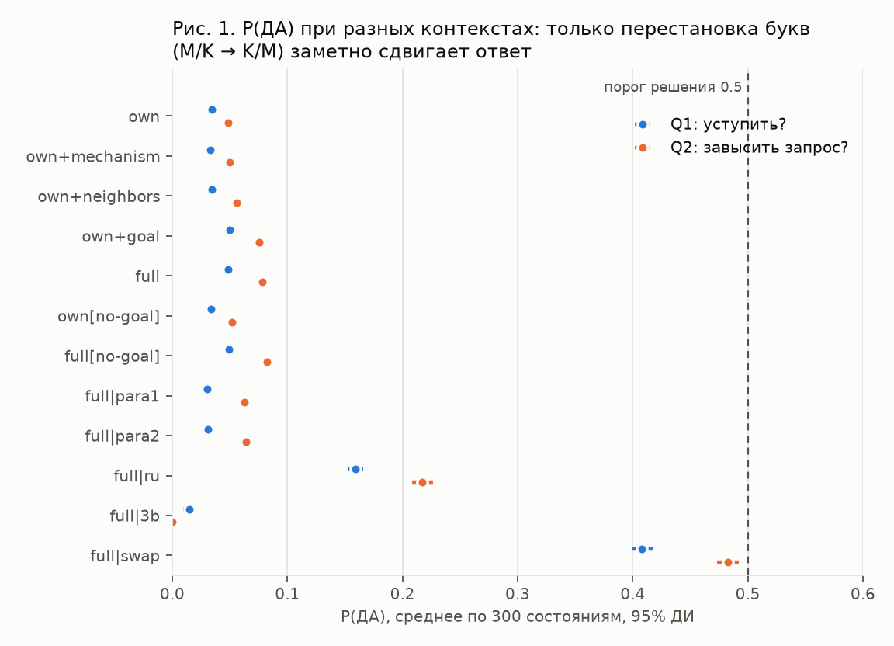
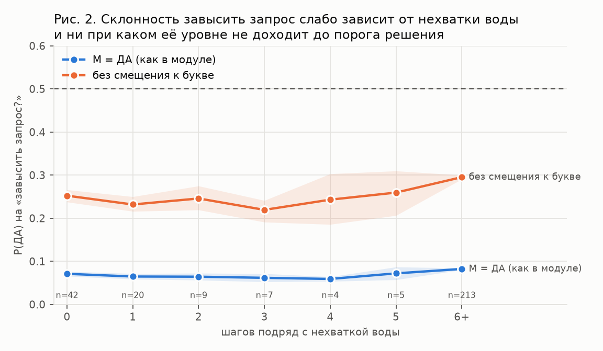
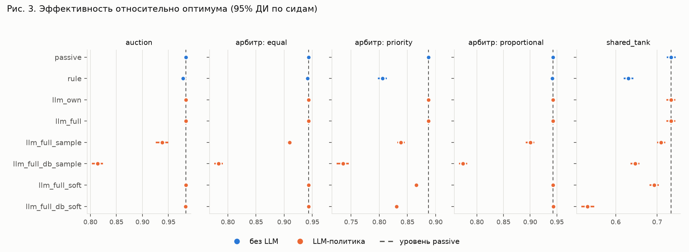

# Решение одним токеном как политика агента в конфликте «зона против системы»

Отчёт по экспериментам: модуль «решение одним токеном» подключён к модели
конфликта m2m (Mesa, 3 зоны орошения, 5 механизмов распределения воды).
Модель — `qwen2.5:1.5b` (контроль — `qwen2.5:3b`), Ollama 0.20.7, всё локально.

Все числа ниже воспроизводятся скриптами из раздела «Воспроизведение»;
полные таблицы — `experiments/results/summary.md`.

## Главное

1. **Модель 1.5b почти не управляется контекстом.** На 300 реальных состояниях
   ни один набор контекста (своё состояние, механизм, соседи, цель системы)
   не перевернул ни одного решения: на оба вопроса — «уступить воду?» и
   «завысить запрос?» — ответ «нет» в 100% случаев. Контекст сдвигает
   вероятность ответа статистически значимо, но на 0.01–0.03 при пороге 0.5.
2. **Уверенность в основном отражает выбор буквы, а не смысл.** Если поменять
   буквы местами (K = да), P(да) растёт с 0.05–0.08 до 0.41–0.48, а решения
   по вопросу «завысить?» совпадают с исходными только в 52% состояний.
   Уверенность ~0.92–0.95 после устранения этого смещения падает до ~0.72–0.77.
   `mass` при этом не ниже 0.986 во всех условиях, то есть проверка по `mass` смещения не ловит.
3. **Если заставить LLM-агента действовать (случайный выбор с вероятностью
   P(да) без смещения), система теряет 9–17 п.п. эффективности во всех схемах**
   — и столько же теряет *случайная* политика с теми же частотами действий.
   Больше того, во всех 5 схемах LLM немного хуже такой случайной политики
   (на ~0.02; значимо в 3 из 5 схем).
4. **Вред идёт не от «жадности», а от «уступчивости».** В схемах с
   распределителем и в аукционе систему разрушает REFUSE (зона уступает
   воду в условиях общего дефицита — вода остаётся неиспользованной, а корень
   в целевой функции наказывает за нулевую долю). Завышение запроса вредит
   только там, где механизм его не нейтрализует: в схеме по приоритету и в
   общем баке.
5. **Механизм важнее агента.** Пропорциональный, равный распределитель и
   аукцион нейтрализуют завышение запросов (эффективность не меняется ни при
   правиле, ни при плавном завышении по LLM); приоритет и общий бак — нет.

Для статьи отсюда следует честная формулировка: *на уровне 1.5b «LLM-агент»
в этой постановке — это не агент, а источник шума со смещением к букве;
механизм распределения и защита от смещения определяют результат сильнее,
чем содержание контекста.* Это отрицательный результат, но измеренный
аккуратно и полезный как калибровка перед переходом на модели крупнее.

## 1. Постановка

**Среда.** `ConflictModel`: источник даёт 6 единиц воды за шаг, три зоны
просят до 5 каждая (дефицит постоянный). Приоритеты (ценность культуры)
1 / 2 / 1. Польза системы = Σ приоритет × √(полученная вода); эффективность =
польза / оптимум при той же реальной потребности. Зона может использовать не
больше своей потребности; полученное сверх неё теряется.

**Режимы зоны.** `passive` — просит ровно свою потребность. `autonomous` —
решает политика: ACCEPT (просить потребность), REFUSE (не просить в этот
шаг), MODIFY (просить вдвое больше).

**Решение LLM.** Два бинарных вопроса одним токеном:
Q1 «уступить воду в этот шаг?» → ДА = REFUSE; иначе Q2 «запросить больше,
чем нужно?» → ДА = MODIFY, НЕТ = ACCEPT. `temperature=0`, `num_predict=1`,
разбирается топ-10 `logprobs`. Промпт: системная инструкция + два примера
(без примеров 1.5b отвечает словом «Yes», а не буквой). При `mass < 0.9` —
откат на правило (ни разу не понадобился).

**Контекст** собирается из блоков: `own` (своя потребность, запас, сколько
шагов недополучает, цель «максимум воды себе»), `mechanism` (как делится
вода), `neighbors` (потребности и голод других зон), `goal` (цель сети и
смысл корня). Числа округлены до 0.5, счётчик голода ограничен «5 и более».

## 2. Этап 0 — проверка здоровья

| модель | язык | буквы | верно | min mass |
|---|---|---|---|---|
| qwen2.5:1.5b | en | M=да | 6/6 | 0.9992 |
| qwen2.5:1.5b | en | K=да | 6/6 | 0.9993 |
| qwen2.5:1.5b | ru | M=да | 5/6 | 0.9977 |
| qwen2.5:3b | en | M=да | 6/6 | 1.0000 |

Основной язык — английский: на русском 1.5b ошибается в одном вопросе.

## 3. Этап 1 — какой контекст переворачивает решение (RQ1)

300 состояний (по 60 на схему) из прогонов в пассивном режиме; каждому
заданы оба вопроса при разных наборах блоков. Решения LLM на симуляцию не
влияли.



Сдвиг P(да) относительно контекста `own` (парно по состоянию):

| блок | «уступить?» ΔP [95% ДИ] | «завысить?» ΔP [95% ДИ] | перевороты решений |
|---|---|---|---|
| + mechanism | −0.001 [−0.003; 0.000] | +0.002 [−0.002; 0.006] | 0% |
| + neighbors | 0.000 [−0.002; 0.001] | +0.007 [0.005; 0.010] | 0% |
| + goal | **+0.015** [0.014; 0.017] | **+0.027** [0.025; 0.029] | 0% |
| все блоки | +0.014 [0.012; 0.016] | +0.030 [0.026; 0.033] | 0% |
| без фразы «цель — максимум себе» | −0.001 | +0.003 | 0% |

Что это значит:

- Единственный блок с заметным эффектом — **цель системы**, и он действует
  против интуиции: знание, что сети выгодно распределять воду, *повышает*
  склонность завысить запрос.
- Якорения на заявленной локальной цели нет: её удаление ничего не меняет.
- Реакция на голод слабая (рис. 2): ρ Спирмена P(завысить) с числом шагов
  нехватки = 0.34 при полном контексте, но при контексте `own` знак обратный
  (−0.25). Ни при каком уровне голода вероятность не подходит к порогу.



## 4. Этап 4 — устойчивость (RQ4)

Полный контекст, варианты против базового (буквы M/K, формулировка 0, en, 1.5b):

| вариант | P(да) «уступить» / «завысить» | совпадение решений | ρ P(да) с базой |
|---|---|---|---|
| буквы переставлены | 0.408 / 0.483 | 87% / **52%** | 0.40 / 0.40 |
| перефразировка 1 | 0.030 / 0.062 | 100% / 100% | 0.53 / 0.16 |
| перефразировка 2 | 0.031 / 0.064 | 100% / 100% | 0.44 / 0.19 |
| русский язык | 0.159 / 0.217 | 100% / 100% | 0.24 / 0.13 |
| qwen2.5:3b | 0.015 / 0.000 | 100% / 100% | 0.06 / 0.38 |

Решения устойчивы ко всему, кроме перестановки букв, — но устойчивы потому,
что всегда «нет». Ранжирование состояний по P(да) между вариантами совпадает
слабо (ρ 0.06–0.53): какие состояния модель считает «более подходящими для
завышения», зависит от формулировки. Модель 3b ещё категоричнее (P = 0.000).

Смещение к букве и его устранение (среднее двух вариантов букв):

| вопрос | P(да), M=да | P(да), K=да | без смещения | решений «да» без смещения |
|---|---|---|---|---|
| уступить? | 0.049 | 0.408 | 0.229 | 0% |
| завысить? | 0.078 | 0.483 | 0.280 | 0% |

## 5. Этапы 2–3 — замкнутый цикл (RQ2, RQ3)

8 условий × 5 схем × 10 сидов × 80 шагов = 400 прогонов; одинаковые сиды во
всех условиях. Условия: `passive`, `rule` (пороги), `llm_own` / `llm_full`
(решение по порогу 0.5), `*_sample` (случайно с вероятностью P(да)),
`*_db_*` (P(да) без смещения к букве), `*_soft` (запрос = потребность ×
(1 + P(завысить))).



Изменение эффективности относительно `passive` (Уилкоксон по сидам;
при 10 сидах минимальное p = 0.002):

| условие | аукцион | равный | приоритет | пропорц. | общий бак |
|---|---|---|---|---|---|
| rule | −0.005 | −0.001 | **−0.082** | −0.001 | **−0.103** |
| llm_own, llm_full | 0 | 0 | 0 | 0 | 0 |
| llm_full_sample | −0.045 | −0.034 | −0.050 | −0.043 | −0.024 |
| llm_full_db_sample | **−0.169** | **−0.160** | **−0.152** | **−0.168** | −0.086 |
| llm_full_soft | 0.000 | 0.000 | −0.022 | 0.000 | −0.041 |
| llm_full_db_soft | −0.001 | 0.000 | −0.057 | +0.001 | **−0.202** |

- `llm_own` и `llm_full` совпадают с `passive` до последнего знака: модель
  ни разу не выбрала REFUSE или MODIFY (12 000 решений).
- Плавное завышение (`soft`) безвредно в пропорциональной, равной схемах и
  аукционе — симметричное завышение гасит само себя — и вредно в схеме по
  приоритету и в общем баке.

**Контроль: случайная политика с теми же частотами действий**
(`experiments/random_baseline.py`, частоты взяты из `llm_full_db_sample`):

| схема | REFUSE / MODIFY | случайная, Δ | только REFUSE, Δ | только MODIFY, Δ | LLM − случайная | p |
|---|---|---|---|---|---|---|
| аукцион | 21% / 25% | −0.151 | −0.146 | −0.009 | −0.018 | 0.037 |
| равный | 25% / 21% | −0.141 | −0.141 | 0.000 | −0.019 | 0.002 |
| приоритет | 22% / 22% | −0.134 | −0.089 | −0.053 | −0.018 | 0.010 |
| пропорц. | 26% / 21% | −0.152 | −0.145 | −0.008 | −0.016 | 0.064 |
| общий бак | 23% / 16% | −0.069 | −0.030 | −0.039 | −0.017 | 0.084 |

LLM теряет столько же, сколько случайная политика, и немного больше неё во
всех пяти схемах. Возможное объяснение — наблюдение из этапа 1: склонность
уступить и завысить растёт, когда зона дольше недополучает, а в дефиците
уступать именно голодной зоне дороже всего. Это гипотеза, а не доказанный
механизм.

**RQ3 — уверенность как сигнал.** Порог «спорного» решения (confidence < 0.6)
практически не срабатывает: 0–0.1% решений, потому что уверенность завышена
смещением к букве. Связь уверенности с потерями слабая (ρ = 0.23–0.27 в
условиях `soft`, ≤ 0.03 в остальных) и смешана с положением зоны в очереди
приоритета. В этой постановке уверенность 1.5b **не выделяет** вредные решения.

## 6. Этап 5 — чувствительность правила

27 комбинаций порогов правила × 5 схем × 10 сидов:

| схема | passive | правило min–max | главный фактор |
|---|---|---|---|
| аукцион | 0.983 | 0.962–0.983 | порог уступки |
| равный | 0.943 | 0.929–0.943 | порог уступки |
| приоритет | 0.888 | 0.689–0.887 | порог уступки, затем «через сколько шагов завышать» |
| пропорц. | 0.943 | 0.929–0.943 | порог уступки |
| общий бак | 0.734 | 0.576–0.691 | «через сколько шагов завышать» |

Коэффициент завышения (×1.5 / ×2 / ×3) **не влияет вообще**: при таком
дефиците любой завышенный запрос уже больше всего доступного ресурса, поэтому
вредит сам факт завышения, а не его величина. Выводы о правиле из прошлых
разборов не являются артефактом выбранных порогов.

## 7. Ограничения и угрозы валидности

- **Размер модели.** 1.5b (и 3b в контроле). Модуль задумывался на 7b; на
  моделях крупнее контекст может работать иначе — это главный следующий шаг.
- **Выбор «излишек теряется»** заложен в модель и определяет вред MODIFY.
  Вариант, где излишек возвращается в систему, не проверялся.
- **Двухшаговая схема вопросов** (сначала «уступить?», потом «завысить?»)
  выбрана до экспериментов; обратный порядок не проверялся.
- **Порядок вызова зон** внутри шага детерминирован; при `temperature=0` зоны
  в одинаковом состоянии отвечают одинаково — поэтому добавлены условия
  `sample`.
- **10 сидов × 80 шагов** в замкнутом цикле (план предполагал 30+ сидов);
  доверительные интервалы узкие, но для публикации стоит увеличить.
- **Округление чисел и ограничение счётчика голода** в промпте (ради кэша)
  немного огрубляют контекст.
- **Бак стартует наполовину полным** — разовый запас, смещающий сравнение
  схемы B с остальными.
- **Предметная область** переименована в «орошение» только в текстах
  промптов; код модели конфликта остался прежним.

## 8. Что делать дальше

1. Повторить этапы 1–2 на `qwen2.5:7b-instruct` (как в исходном модуле) и на
   `qwen3.5:9b` (уже установлена): главный вопрос — появятся ли перевороты
   решений, зависящие от контекста.
2. Сделать устранение смещения к букве стандартной частью модуля: для
   бинарного решения одним токеном оно обязательно, `mass` его не ловит.
3. Увеличить число сидов до 30, добавить вариант «излишек возвращается».
4. Проверить обратный порядок вопросов и одну формулировку с тремя
   вариантами ответа (три буквы).

## Воспроизведение

```bash
cd m2m_project/project
python experiments/llm_sanity.py                     # этап 0
python experiments/llm_open_loop.py                  # этапы 1, 4  (~7 мин на RTX 3060)
python experiments/llm_closed_loop.py                # этапы 2, 3  (~25 мин)
python experiments/llm_closed_loop.py --sensitivity  # этап 5
python experiments/random_baseline.py                # контроль: случайная политика
python experiments/llm_analyze.py                    # summary.md и рисунки
```

Код: `src/llm/token_decision.py` (ядро), `src/llm/zone_context.py`
(состояние → текст), `src/model/zone_policies.py` (правило / LLM / запись).
