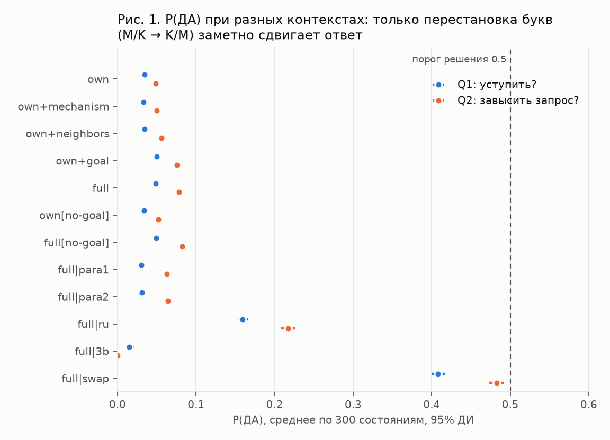
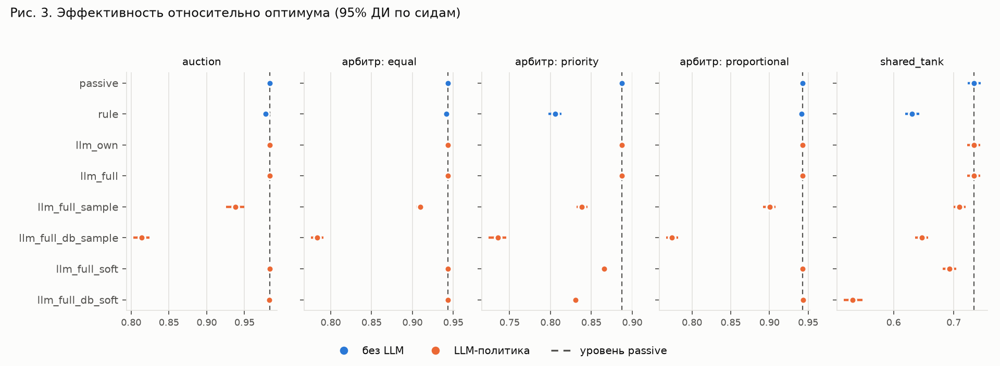
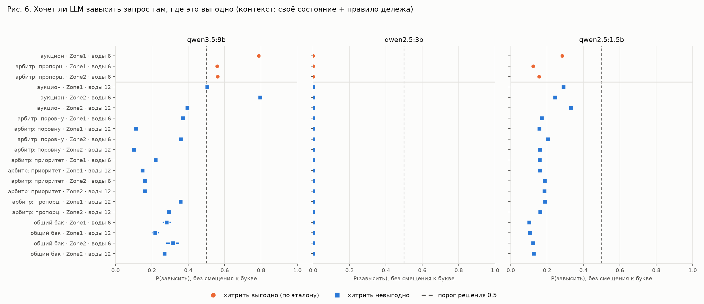
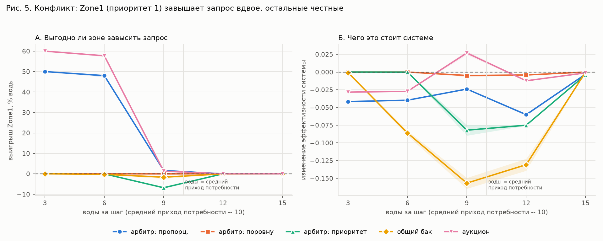

# Отчёт: LLM «одна буква» и проект m2m

Октябрь 2026. Всё работает локально: Python 3.12, Mesa 3.5.1, Ollama 0.20.7,
модели Qwen на RTX 3060 12 ГБ.

## Кратко

Работа состоит из двух частей.

**Часть 1 — модуль «решение одним токеном».** LLM отвечает на вопрос да/нет
ровно одной буквой (M = да, K = нет). Из вероятностей этих букв считается
уверенность модели. Модуль доработан, подключён к агентам m2m и проверен в
трёх экспериментах. Главные выводы:

- маленькая модель `qwen2.5:1.5b` как агент не годится: она ни разу не
  изменила решение от контекста, а её уверенность в основном отражает выбор
  буквы, а не смысл;
- крупная `qwen3.5:9b` уже различает, где агенту выгодно хитрить (AUC 0.95),
  но рассуждает по тексту правила, а не по последствиям.

**Часть 2 — проект m2m (первое задание).** Экспериментальный стенд на Mesa,
где каждый узел — агент: цепочка Input → Machine_A → Buffer → Machine_B →
Output с отказами, восстановлением, очередями, журналом, визуализацией и
вызовом Ollama. Все 11 пунктов демонстрации из задания проверяются одной
командой (`experiments/check_all.py`, результат 12/12). Сверх задания
сделаны режимы работы узлов и модель конфликта «зона против системы» с
экспериментом без LLM.

---

# Часть 1. LLM, которая отвечает одной буквой

## 1.1. Идея

Обычно LLM отвечает текстом, и его приходится разбирать. Здесь модель
отвечает **одним токеном** — буквой ДА или НЕТ. Ollama возвращает
вероятности топ-10 кандидатов на этот токен (`logprobs`), и из них
считаются два числа:

```
confidence = max(P(да), P(нет)) / (P(да) + P(нет))   — уверенность в ответе
mass       = P(да) + P(нет)                          — «здоровье» промпта
```

- `confidence` — насколько модель уверена при данном контексте (не то же
  самое, что правильность).
- `mass` показывает, ушла ли вероятность в посторонние токены. Если
  `mass` < 0.9, ответу верить нельзя, и агент откатывается на обычное
  правило.

Плюсы такого подхода: ответ всегда разбирается, вызов быстрый (генерируется
всего 1 токен), а уверенность получается без повторных запросов.

Код — [`src/llm/token_decision.py`](../src/llm/token_decision.py), функция
`ask(context, question, model, lang, yes_letter, no_letter)`. Параметры
вызова: `/api/chat`, `temperature 0`, `num_predict 1`, `logprobs`,
`top_logprobs 10`.

## 1.2. Что пришлось доработать

| проблема | что сделано |
|---|---|
| `1.5b` без примеров отвечает словом «Yes», а не буквой | системный промпт + 2 примера (few-shot) |
| `qwen3.5:9b` первым токеном начинает рассуждение («Thinking») | параметр `think: false` |
| токены «M» и « M» (с пробелом) — разные | вероятности всех вариантов буквы складываются |
| ответ зависит от того, какая буква означает «да» | вопрос задаётся в двух порядках букв, P(да) усредняется (debias) |
| Ollama при temperature 0 даёт разные ответы на параллельные запросы | в экспериментах запросы только последовательные |
| нужно решение с вероятностью, а не всегда «нет» | режим `sample`: действие выбирается случайно с вероятностью P(да) |

## 1.3. Как модуль подключён к агентам

В модели конфликта m2m (часть 2, раздел 2.6) зона орошения в автономном
режиме выбирает ACCEPT / REFUSE / MODIFY. С LLM решение задаётся двумя
вопросами одним токеном:

```
Q1 «Уступить воду в этот шаг?»     да → REFUSE
          нет ↓
Q2 «Запросить больше, чем нужно?»  да → MODIFY,  нет → ACCEPT
```

Контекст для вопроса собирается из блоков:
- `own` — своя потребность, запас, сколько шагов зона недополучает;
- `mechanism` — как делится вода;
- `neighbors` — состояние соседей;
- `goal` — цель всей сети.

Код — [`src/llm/zone_context.py`](../src/llm/zone_context.py) и
[`src/model/zone_policies.py`](../src/model/zone_policies.py)
(`TokenLLMPolicy`). Если Ollama недоступна, зона решает по правилу. В
веб-интерфейсе есть режим «автономный (LLM)».

## 1.4. Проверка здоровья и смещение к букве

Проверка на простых вопросах (`experiments/llm_sanity.py`):

| модель | язык | буквы | верно | min mass |
|---|---|---|---|---|
| qwen2.5:1.5b | en | M=да | 6/6 | 0.999 |
| qwen2.5:1.5b | en | K=да | 6/6 | 0.999 |
| qwen2.5:1.5b | ru | M=да | 5/6 | 0.998 |
| qwen2.5:3b | en | M=да | 6/6 | 1.000 |
| qwen3.5:9b | en | M=да | 6/6 | ≥ 0.997 |

На простых вопросах модуль работает. На вопросах агента проявляется
**смещение к букве**:

| модель | P(да), если M = да | P(да), если K = да |
|---|---|---|
| qwen2.5:1.5b | 0.05–0.09 | 0.43–0.51 |
| qwen3.5:9b | 0.385 | 0.209 |

У `1.5b` достаточно поменять буквы местами, и решения «завысить запрос»
совпадают с исходными только в 47% случаев. При этом `mass` остаётся ≥ 0.984,
то есть проверка по `mass` смещение не ловит. Поэтому усреднение двух
порядков букв обязательно.



## 1.5. Эксперимент: `qwen2.5:1.5b` как агент зоны

Отчёт — [`llm_experiment_report.md`](llm_experiment_report.md).

**Без обратной связи** (300 реальных состояний зон, решения на модель не
влияют): ни один набор контекста не перевернул ни одного решения. На оба
вопроса ответ «нет» в 100% случаев. Контекст сдвигает P(да) лишь на
0.001–0.036 при пороге 0.5. Самый сильный блок — цель сети, и он *повышает*
склонность и уступить, и завысить запрос.

**В замкнутом цикле** (400 прогонов: 5 механизмов × 8 условий × 10 сидов):

- по порогу 0.5 LLM всегда выбирает ACCEPT, то есть ведёт себя как пассивный
  режим;
- если заставить её действовать (случайный выбор с вероятностью P(да) без
  смещения), система теряет **8–19 п.п.** эффективности;
- столько же теряет **случайная политика** с теми же частотами действий:
  LLM не лучше случайной;
- вред идёт в основном от REFUSE: зона уступает воду, которая потом никому
  не достаётся.



**Вывод:** на уровне 1.5b «LLM-агент» — это источник шума со смещением к
букве. Механизм распределения влияет на результат сильнее, чем содержание
контекста.

## 1.6. Эксперимент: хитрят ли LLM там, где это выгодно

Отчёт — [`llm_incentives_report.md`](llm_incentives_report.md). Эталоном
служит карта стимулов из эксперимента без LLM (раздел 2.6): в 20 ситуациях
(механизм × зона × уровень воды) известно, выгодно ли зоне завысить запрос.
Каждой модели задан вопрос «завысить?» на 400 состояниях, в двух контекстах:
`selfish` (только своё) и `full` (плюс соседи и цель сети).

| модель | P(завысить), где выгодно | где невыгодно | AUC |
|---|---|---|---|
| qwen3.5:9b | 0.635 | 0.298 | **0.95** |
| qwen2.5:1.5b | 0.187 | 0.180 | 0.46 |
| qwen2.5:3b | ≈ 0 | ≈ 0 | — (всегда «нет») |

- **`9b` различает выгодные ситуации.** При одинаковом дефиците различие
  сохраняется (AUC 0.88), решение совпадает с эталоном в 18 из 20 ситуаций.
- **Но рассуждает по тексту правила.** В аукционе одно и то же правило, а
  выгода у зон разная. Модель одинаково хочет хитрить и за Zone1 (выгодно,
  P = 0.79), и за Zone2 (невыгодно, P = 0.80); AUC 0.50.
- **Знание цели сети конфликт не снимает.** Там, где хитрость выгодна зоне и
  вредна системе, P падает лишь с 0.67 до 0.59.
- **Это мораль, а не расчёт.** Сильнее всего цель сети подавляет хитрость
  там, где она системе *полезна* (с 0.56 до 0.28).



## 1.7. Ограничения и что дальше

- Эксперимент с `9b` проведён без обратной связи. Сколько реально теряет
  система, если зонами управляет `9b`, — следующий шаг (замкнутый цикл,
  ~3 часа вычислений).
- Одна формулировка вопроса, одно семейство моделей (Qwen). Нужны
  перефразировки и модель другого семейства.
- Выгодных ситуаций в эталоне всего 3 из 20; нужны новые ситуации, где
  правило выглядит одинаково, а выгода разная.

---

# Часть 2. Проект m2m (Mesa + Ollama)

## 2.1. Задание и стек

Первое задание — подготовить open-source инфраструктуру: Mesa-модель из
3–5 узлов с состояниями, отказами, журналом и визуализацией, плюс вызов
локальной LLM из Python. Подробный отчёт по разделам задания —
[`report_stage1.md`](report_stage1.md).

| компонент | версия |
|---|---|
| ОС | Ubuntu 24.04 |
| Python | 3.12.3 |
| Mesa | 3.5.1 |
| Ollama | 0.20.7 |
| модели | `qwen2.5:1.5b`, `qwen2.5:3b`, `qwen3.5:9b` |
| Flask | 3.1.3 (веб-визуализация) |
| Git | 2.43.0 |
| Docker | 29.1.3 |

Все пакеты Python закреплены в `requirements.txt` на проверенных версиях.

## 2.2. Архитектура

```
mesa.Model (FactoryModel)
 ├── InputAgent   ──>  NodeAgent "Machine_A"  ──>  NodeAgent "Buffer"
 │                                                     │
 │                                                     v
 └── OutputAgent  <──  NodeAgent "Machine_B"  <────────┘
```

- **Агенты.** Каждый узел — наследник `mesa.Agent`. Mesa сама даёт
  `unique_id` и регистрирует агента в модели.
- **Состояние** хранится в атрибутах агента: `state` (IDLE / WORKING /
  BLOCKED / FAILED), `current_task`, `queue`, `load`, `available`,
  `priority`. Метод `state_dict()` отдаёт его в формате из задания.
- **Шаг модели.** `model.step()` вызывает `step()` у всех агентов через
  Mesa `AgentSet` в порядке цепочки.
- **Модели.** `FactoryModel` (цепочка из задания), `PipelineModel` (насос →
  клапан → бак, три варианта клапана), `ConflictModel` (распределение воды
  между зонами).

## 2.3. Отказ, восстановление, визуализация, журналы

Сценарий из задания (`experiments/run_demo.py`): поступают задачи, на шаге
4 Machine_B отказывает на 5 шагов, задачи копятся в очереди, на шаге 9
Machine_B восстанавливается, и система продолжает работу. Задачи не
теряются: если следующий узел не принимает задачу, узел переходит в BLOCKED
и держит её у себя.

**Визуализация:**
- текст в консоли;
- веб-интерфейс `python live_server.py` → http://localhost:5050: узлы,
  связи, состояния, задачи, очереди, кнопки «Шаг», «Отказ (5 шагов)»,
  «Восстановить», добавление узлов на ходу, переключение режимов.

**Журналы** (JSON Lines):
- `logs/events.jsonl` — timestamp, simulation_step, node_id, old_state,
  new_state, event, task_id;
- `logs/llm_calls.jsonl` — вход и выход LLM, модель, время ответа.

## 2.4. Ollama и интеграция

Цепочка: `Mesa Node State → Python → Ollama → Recommendation`. Состояние
узла отправляется в LLM, ответ — JSON вида
`{"recommendation": "do_not_accept_new_tasks"}`. Как требует задание,
рекомендация только пишется в журнал и не меняет модель.

Стабильность JSON (`experiments/json_stability.py`, 27 состояний узла):

| модель | валидный JSON | ответ по правилу из промпта | время ответа |
|---|---|---|---|
| qwen2.5:1.5b | 27/27 | 16/27 | 0.5 с |
| qwen2.5:3b | 27/27 | 23/27 | 0.6 с |
| qwen3.5:9b | 27/27 | 25/27 | 0.9 с |

Формат держится всегда, смысл — нет: `1.5b` советует «не принимать задачи»
даже простаивающему узлу. Поэтому рекомендации LLM нельзя применять без
проверки.

## 2.5. Режимы узлов

Режим переключается на ходу, в коде и в веб-интерфейсе.

| режим | что делает узел |
|---|---|
| пассивный | «просто труба»: принимает задачу, если есть место, и передаёт дальше |
| автономный | сам решает: REFUSE, если очередь ≥ 80% или следующий узел в отказе; ACCEPT снова, когда очередь < 50% |
| автономный (LLM) | только в модели конфликта: решение зоны принимает LLM одним токеном (часть 1) |

Каждое решение пишется в журнал с причиной.

## 2.6. Модель конфликта и эксперимент без LLM

Это задел для второго этапа (Global Goal → Local Context → Agent →
ACCEPT / REFUSE / MODIFY). Источник даёт воду, три зоны орошения (агенты) с
разной ценностью культуры её делят:
- **цель системы** — максимум общей пользы Σ приоритет × √вода;
- **цель зоны** — больше воды себе.

Пять механизмов делёжа: пропорционально запросу, поровну, по приоритету,
общий бак, аукцион.

- **Коллизия** — зоны одновременно претендуют на воду, которой не хватает на
  всех.
- **Конфликт** — зоне выгодно взять больше, а системе это вредно.

Результаты 2000 прогонов (`docs/conflict_collision_report.md`):

- коллизия возникает только при нехватке воды;
- настоящий конфликт есть только в двух механизмах — пропорциональном и
  аукционе: зона, завысив запрос, получает на 48–60% больше, система теряет
  3–4 п.п.;
- делёж поровну устойчив к обману;
- в общем баке, если хитрят все, система теряет 22–40 п.п. — трагедия
  общин.



Эта карта стимулов — эталон для эксперимента 1.6.

## 2.7. Проблемы и исправления

| проблема | решение |
|---|---|
| задачи терялись при отказе узла | состояние BLOCKED, задача ждёт у узла |
| в схеме по приоритету зона с равным приоритетом голодала (польза 512 против 12) | при равенстве первой получает зона, получившая меньше всего |
| вода, потерянная при отказах, не учитывалась | баланс: произведено = использовано + потеряно + в баке |
| Mesa 3.5.1 импортирует `networkx`, но не ставит его — в чистой среде `import mesa` падал | все пакеты закреплены в `requirements.txt` |
| SolaraViz ломался из-за версий фронтенд-пакетов | свой просмотрщик на Flask |
| адрес Ollama читался из разных переменных | одна переменная `OLLAMA_HOST` (работает и в Docker) |

## 2.8. Как запустить и проверить

```bash
cd m2m_project/project
source ../../.venv/bin/activate
pip install -r requirements.txt

python experiments/check_all.py          # 11 пунктов задания: ✔/✘
python experiments/run_demo.py           # сценарий отказа и восстановления
python live_server.py                    # браузер: http://localhost:5050
python -m unittest discover -s tests     # 28 тестов
```

Эксперименты:

```bash
python experiments/conflict_collision.py   # без LLM, ~20 с
python experiments/llm_sanity.py           # проверка модуля «одна буква»
python experiments/llm_open_loop.py        # 1.5b без обратной связи, ~7 мин
python experiments/llm_closed_loop.py      # 1.5b в замкнутом цикле
python experiments/llm_incentives.py       # 3 модели и карта стимулов, ~25 мин
```

---

# Итог

- **Первое задание выполнено полностью**: все 11 пунктов демонстрации
  проверяются автоматически, проект собирается с нуля и в Docker, есть
  28 тестов.
- **Модуль «одна буква» встроен в агентов** и измерен. Маленькие модели как
  агенты не годятся. `qwen3.5:9b` становится стратегическим агентом: находит,
  где выгодно хитрить, и лишь частично сдерживается знанием общей цели.
  Это центральный результат для статьи.

**Следующие шаги:**
1. Замкнутый цикл с `qwen3.5:9b` (~3 часа).
2. Перефразировки вопроса и модель другого семейства.
3. Перенос схемы «зона против системы» на одну из предметных областей из
   `docs/domains.md`.
