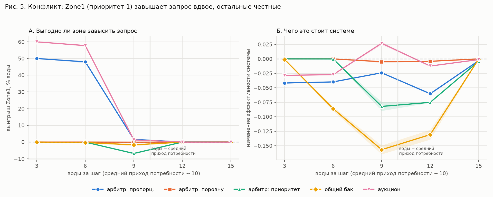
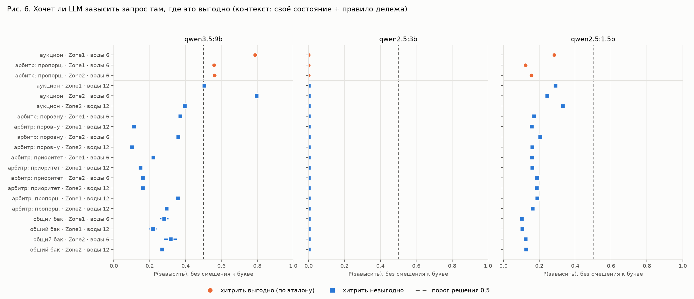

# Отчёт по первому заданию: инфраструктура для экспериментов с агентной системой

Стенд: Mesa 3.5.1 + Ollama 0.20.7 (локальные модели Qwen) + Python 3.12,
всё open source. Каждый узел системы — отдельный `mesa.Agent`.

**Итог.** Все 11 пунктов из раздела «Что необходимо подготовить к
демонстрации» выполнены и проверяются одной командой (результат — 12/12:
11 пунктов плюс интеграция Mesa → Ollama). Разделы 1–6 ниже отвечают на
вопросы из раздела «Краткий отчёт». Сверх задания подготовлены заделы для
второго этапа (Global Goal → Local Context → Agent →
ACCEPT/REFUSE/MODIFY): режимы работы узлов, модель конфликта «зона против
системы» и три эксперимента (раздел 7).

## Как проверить за 5 минут

```bash
cd m2m_project/project
source ../../.venv/bin/activate

python experiments/check_all.py      # 11 пунктов демонстрации: ✔/✘ и доказательство
python experiments/run_demo.py       # сценарий из задания: Task 1–3, отказ Machine_B, восстановление
python experiments/run_demo.py --with-ollama --quiet   # + рекомендации LLM (только в журнал)
python live_server.py                # визуализация в браузере: http://localhost:5050
python -m unittest discover -s tests # 28 тестов
```

В браузере: выбрать модель `factory`, нажимать «Шаг», выбрать Machine_B и
нажать «Отказ (5 шагов)», посмотреть, как растёт очередь, затем «Восстановить». Журнал этого
прогона — в `logs/events.jsonl` и `logs/llm_calls.jsonl`.

| пункт демонстрации | где видно |
|---|---|
| 1. установленный Mesa | `check_all.py`: `mesa 3.5.1` |
| 2. работающая модель | `FactoryModel(mesa.Model)`, `run_demo.py` |
| 3. 3–5 узлов | Input → Machine_A → Buffer → Machine_B → Output |
| 4. движение задач | путь Task_1: Machine_A → Buffer → Machine_B → Output |
| 5. изменение состояний | IDLE / WORKING / BLOCKED / FAILED на экране и в журнале |
| 6. отказ узла | шаг 4: Machine_B = FAILED, `available = false` |
| 7. восстановление | шаг 9: Machine_B снова работает, задачи идут дальше |
| 8. визуализация | консоль (`console_visualizer.py`) и браузер (`live_server.py`) |
| 9. журнал работы | `logs/events.jsonl`: timestamp, simulation_step, node_id, old_state, new_state, event, task_id |
| 10. Python-вызов Ollama | `python -m src.llm.ollama_client` |
| 11. структурированный ответ | `{"node": "Machine_A", "state": "busy", "queue": 5}` → `{"status": "overloaded"}` |

## 1. Инфраструктура

| компонент | версия | зачем |
|---|---|---|
| ОС | Ubuntu 24.04 | |
| Python | 3.12.3 | |
| Mesa | 3.5.1 | среда агентного моделирования |
| Ollama | 0.20.7 | локальный запуск LLM (нужна версия с `logprobs`) |
| локальные модели | `qwen2.5:1.5b`, `qwen2.5:3b`, `qwen3.5:9b` | 1.5b/3b — демонстрация, 9b — эксперимент |
| Flask | 3.1.3 | веб-визуализация `live_server.py` |
| Solara | 1.62.0 | опционально: стандартный SolaraViz (`experiments/gui.py`) |
| Git | 2.43.0 | репозиторий проекта |
| Docker | 29.1.3 | `docker/Dockerfile`, `docker/docker-compose.yml` |
| железо | RTX 3060 12 ГБ, 6 CPU | |

Версии печатает `experiments/check_all.py`. Зависимости Python закреплены
в `requirements.txt` ровно на проверенных версиях. Инструкция запуска — в
`README.md`.

**Docker.** `docker/docker-compose.yml` поднимает три сервиса: `ollama`,
`ollama-pull` (один раз скачивает `qwen2.5:1.5b`) и `app` (демо-сценарий с
рекомендациями LLM). Проверено: образ собирается с нуля; в контейнере
проходят все 28 тестов, `check_all.py` даёт 12/12 (вызов Ollama на хосте) и
открывается веб-визуализация. Запуск всех трёх сервисов через
`docker compose up` на этой машине не проверен: не установлен плагин
`docker compose`. Основной способ запуска — напрямую в ОС (venv), как
разрешает задание.

## 2. Mesa

**Как создаются агенты.** Каждый узел — класс-наследник `mesa.Agent`:
`NodeAgent` (машина, буфер), `InputAgent` (источник задач), `OutputAgent`
(сток). Агент создаётся конструктором `NodeAgent(model, name=...)`: Mesa
сама присваивает `unique_id` и регистрирует агента в `model.agents`. Модель —
наследник `mesa.Model` (`FactoryModel`, `PipelineModel`, `ConflictModel`),
она создаёт агентов и связывает их в цепочку (`downstream`).

**Как хранится состояние.** Состояние хранится в обычных атрибутах объекта
агента: `state`, `current_task`, `queue` (список задач), `load`, `available`,
`priority`. Метод `state_dict()` отдаёт его в формате из задания:

```json
{"node": "Machine_B", "state": "failed", "current_task": null, "queue": 2,
 "load": 0.2, "available": false, "priority": "normal"}
```

**Как выполняются шаги.** `model.step()` вызывает `step()` у всех агентов
через Mesa `AgentSet` в порядке цепочки (Input → … → Output). Счётчик
`model.steps` Mesa увеличивает сама. Задача за шаг проходит не больше одного
этапа обработки на каждом узле. Отказ задаётся на N шагов
(`trigger_failure`), восстановление происходит само или по кнопке.

**Взаимодействие агентов.** Узел передаёт задачу следующему узлу
(`accept_task`). Если тот в отказе или его очередь полна, задача не
теряется: узел переходит в BLOCKED и держит её у себя, и затор идёт назад по
цепочке. Это и есть «влияние отказа на движение задач».

**Статистика.** В модели конфликта используется `mesa.DataCollector`
(эффективность, справедливость, потери). В цепочке статистику дают журнал
событий и счётчики `completed_tasks`, `avg_lead_time`.

**Визуализация.** В Mesa 3 встроен SolaraViz (сетки, сети, графики в
браузере через Jupyter-стек); пример — `experiments/gui.py`. Для показа
цепочки узлов сделан собственный лёгкий просмотрщик на Flask + HTML
(`live_server.py`). Он показывает узлы, связи, состояние, текущую задачу и
очередь, умеет вызывать отказ и восстановление любого узла, добавлять узлы
на ходу и переключать режимы. Есть и текстовая визуализация в консоли.

**Какие ограничения обнаружены:**
- В Mesa нет понятий «задача», «очередь», «время обработки», «связь между
  узлами». Всё это пришлось писать самим поверх `Agent`: Mesa даёт каркас
  (агенты, шаги, сбор данных, случайность), но не модель потоков.
- Время дискретное: всё происходит по шагам, событий «в момент t» нет. Для
  потока задач этого хватает, для точных длительностей понадобилась бы
  дискретно-событийная модель.
- В Mesa 3 убраны планировщики (`RandomActivation` и др.), вместо них
  `AgentSet.do` / `shuffle_do`. Многие примеры и учебники в интернете
  написаны под Mesa 2 и не работают.
- Порядок активации агентов влияет на результат шага. Для цепочки он
  фиксирован (Input → … → Output), чтобы прогоны были предсказуемыми. В модели конфликта случайный порядок используется
  намеренно (зоны берут воду из общего бака, никто не координирует).
- SolaraViz зависит от фронтенд-пакетов Jupyter (ipyvue, ipyvuetify). У нас
  ломалась их связка, поэтому основной просмотрщик — на Flask.

## 3. Ollama

**Модели.** `qwen2.5:3b` — для демонстрации и рекомендаций, `qwen2.5:1.5b` —
для быстрых прогонов, `qwen3.5:9b` — самая крупная, что помещается в 12 ГБ
видеопамяти.

**Как выполняется вызов из Python.** HTTP-запрос к локальному серверу Ollama
(`requests.post` на `/api/generate`) с параметром `format: "json"` — Ollama
ограничивает вывод грамматикой JSON (`src/llm/ollama_client.py`). Адрес
сервера берётся из переменной `OLLAMA_HOST`, как у самого `ollama`, поэтому
тот же код работает и в Docker. В экспериментах используется второй способ
— `/api/chat` с `logprobs`: модель отвечает одной буквой, и из вероятностей
токенов считается уверенность (`src/llm/token_decision.py`).

**Получается ли стабильно возвращать JSON — да, по формату; нет, по смыслу.**
Замер (`experiments/json_stability.py`): промпт рекомендаций из интеграции,
27 состояний узла (idle / working / failed × 9 уровней загрузки),
temperature 0.

| модель | валидный JSON | правильная схема | ответ по правилу из промпта | время ответа (медиана) |
|---|---|---|---|---|
| qwen2.5:1.5b | 27/27 | 27/27 | 16/27 | 0.5 с |
| qwen2.5:3b | 27/27 | 27/27 | 23/27 | 0.6 с |
| qwen3.5:9b | 27/27 | 27/27 | 25/27 | 0.9 с |

- Формат держится у всех моделей: 100% валидный JSON с нужным ключом и
  допустимым значением. Благодаря примерам в промпте это верно даже без
  `format: "json"`, но с ним гарантия идёт от самой Ollama.
- Смысл ответа держится хуже. `1.5b` почти всегда советует «не принимать
  задачи», даже простаивающему узлу. `3b` ошибается при загрузке 0.7–0.8.
  `9b` — только на границе 0.8 (в промпте «выше 0.8»). Поэтому рекомендацию
  LLM нельзя принимать без проверки, и на первом этапе она, как и требует
  задание, только пишется в журнал.

## 4. Интеграция

```
Mesa Node State ──> Python (NodeAdvisor) ──> Ollama ──> Recommendation ──> журнал + экран
```

`run_demo.py --with-ollama` на каждом шаге отправляет состояние занятых
узлов в LLM и печатает рекомендацию. Состояние модели рекомендация **не
меняет**. Каждая запись в `logs/llm_calls.jsonl` содержит всё, что требует
задание:

```json
{"timestamp": "2026-09-26T14:13:29Z", "simulation_step": 20, "node_id": "Machine_B",
 "model_name": "qwen2.5:3b",
 "llm_input": {"node": "Machine_B", "state": "working", "current_task": "Task_4",
               "queue": 2, "load": 0.2, "available": true, "priority": "normal"},
 "llm_output": {"recommendation": "accept_new_tasks"},
 "response_time_sec": 0.498, "error": ""}
```

Если Ollama недоступна, модель продолжает работать, а ошибка пишется в
журнал (поле `error`).

## 5. Проблемы установки и интеграции

| проблема | как решено |
|---|---|
| Mesa 3 несовместима с примерами под Mesa 2 (нет планировщиков) | шаг через `AgentSet`, всё переписано под 3.5.1 |
| SolaraViz ломался из-за версий ipyvue / ipyvuetify | свой просмотрщик на Flask + HTML |
| задачи терялись при отказе узла и при полной очереди следующего | состояние BLOCKED: задача ждёт у узла, затор идёт назад по цепочке; покрыто тестами |
| `qwen3.5:9b` начинает ответ с рассуждения («Thinking»), а не с ответа | параметр `think: false` во всех вызовах |
| `1.5b` без примеров отвечает словом «Yes», а не буквой | системный промпт + 2 примера (few-shot) |
| смещение к букве: ответ зависит от того, какая буква значит «да» | каждый вопрос задаётся в двух порядках букв, вероятности усредняются |
| Ollama при temperature 0 даёт разные ответы на параллельные запросы | в экспериментах запросы последовательные |
| адрес Ollama в двух модулях читался из разных переменных (в Docker LLM-часть ушла бы на localhost) | одна переменная `OLLAMA_HOST` |
| Mesa 3.5.1 импортирует `networkx`, но не ставит его; в чистой среде (Docker) `import mesa` падает | `networkx` и все остальные пакеты закреплены в `requirements.txt`; найдено при сборке образа |
| нет плагина `docker compose` на машине | образ проверен через `docker build`; основной запуск — в ОС |

## 6. Предложения: какие свойства узла реализовать дальше

Часть из них уже сделана как задел (отмечено ✔).

- ✔ **Режим принятия решений**: пассивный (узел — «просто труба») и
  автономный (узел сам решает ACCEPT / REFUSE по своей загрузке и состоянию
  соседа); переключается на ходу.
- ✔ **Решение с причиной**: каждое ACCEPT / REFUSE / MODIFY пишется в журнал
  с объяснением.
- ✔ **Локальная цель и приоритет** (в модели конфликта: ценность культуры
  зоны, её потребность, сколько шагов подряд она недополучает).
- **Стоимость и время**: цена простоя, штраф за задержку задачи — чтобы
  глобальная цель считалась в деньгах или времени.
- **Надёжность**: вероятность отказа и время ремонта как случайные
  величины, а не заданные вручную.
- **Память и репутация**: сколько раз узел отказывал соседям, — основа для
  переговоров между узлами.
- **Коммуникация**: узел может спросить соседа, а не только передать
  задачу.

## Дополнительное задание: две предметные области

Описаны в `docs/domains.md`: курьерская доставка еды и очередь печати в
типографии. Для каждой указаны узел, задача, состояния, ограниченный
ресурс, глобальная цель, локальные приоритеты и конфликт. Третья область —
распределение воды между зонами орошения — не только описана, но и
реализована (раздел 7).

## 7. Сверх задания: заделы для второго этапа

Задание ставит на следующий этап исследование схемы Global Goal → Local
Context → Agent → ACCEPT/REFUSE/MODIFY и конфликта глобальной цели с
локальными приоритетами. Для этого уже сделано:

**Модель конфликта** (`src/model/conflict_model.py`). Источник даёт воду,
три зоны орошения (агенты) с разной ценностью культуры её делят. Цель
системы — максимум общей пользы, цель зоны — больше воды себе. Коллизия
разрешается пятью механизмами: пропорционально, поровну, по приоритету,
общий бак, аукцион. Зона в автономном режиме выбирает ACCEPT (запросить
потребность), REFUSE (уступить) или MODIFY (завысить запрос).

**Эксперимент 1 — без LLM** (`docs/conflict_collision_report.md`, 2000
прогонов):
- коллизия есть только при нехватке воды;
- настоящий конфликт «зоне выгодно, системе вредно» есть только в двух
  механизмах из пяти (пропорциональном и аукционе): зона получает на 48–60%
  больше, система теряет 3–4 п.п.;
- равный делёж устойчив к обману;
- в общем баке, если хитрят все, система теряет 22–40 п.п. (трагедия
  общин).

**Эксперимент 2 — решение зоны локальной LLM одним токеном**
(`docs/llm_experiment_report.md`): модель `1.5b` как агент — источник шума
со смещением к букве. Если дать ей управлять зонами, система теряет 8–19
п.п., столько же, сколько случайная политика.

**Эксперимент 3 — хитрят ли LLM там, где это выгодно**
(`docs/llm_incentives_report.md`, 3 модели × 400 состояний):
- `qwen3.5:9b` различает, где зоне выгодно завысить запрос (AUC 0.95),
  и совпадает с эталоном из эксперимента 1 в 18 ситуациях из 20;
- рассуждает она по тексту правила, а не по последствиям;
- знание цели всей сети снижает хитрость, но в ситуациях настоящего
  конфликта большинство решений всё равно «хитрить» (P = 0.59);
- модели 1.5b и 3b ситуации не различают.





**Как это согласуется с ограничениями первого этапа.** В основном стенде
(цепочка Input → … → Output) LLM только советует, решения не меняют модель.
Право действовать LLM получает лишь в отдельной модели конфликта, в режиме
«автономный (LLM)», который по умолчанию выключен и нужен для экспериментов
второго этапа.

**Что дальше:**
1. Замкнутый цикл с `qwen3.5:9b`: сколько реально теряет система, если
   зонами управляет крупная модель (~3 часа вычислений).
2. Проверить выводы на другой формулировке вопроса и на модели другого
   семейства (не Qwen).
3. Перенести схему «зона против системы» на одну из областей из
   `docs/domains.md` (например, курьеров).

## Где что лежит

```
project/
├── README.md                 инструкция запуска
├── requirements.txt
├── src/
│   ├── agents/               Mesa-агенты: NodeAgent, Input/Output, клапаны
│   ├── model/                Mesa-модели: FactoryModel, PipelineModel, ConflictModel, политики зон
│   ├── simulation/           журнал (logger.py), текстовая визуализация
│   └── llm/                  Ollama: JSON-клиент, советчик, решение одним токеном
├── experiments/              check_all, run_demo, json_stability, эксперименты 1–3; results/ — таблицы
├── tests/                    28 тестов (unittest)
├── docs/                     этот отчёт, отчёты экспериментов, domains.md, figures/
├── docker/                   Dockerfile, docker-compose.yml
├── logs/                     events.jsonl, llm_calls.jsonl
├── live_server.py            веб-визуализация
└── live_viewer.html
```
